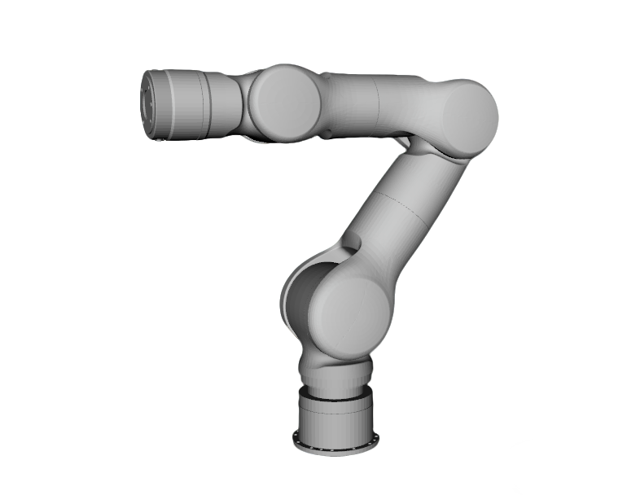
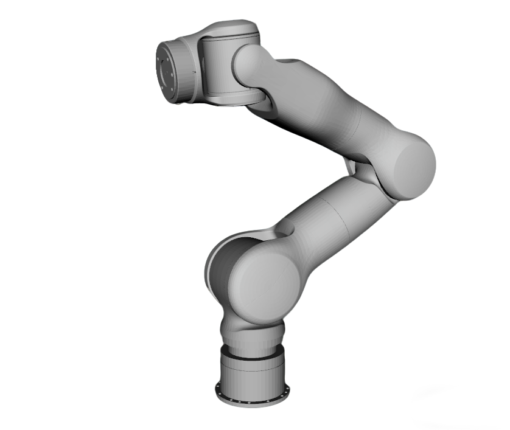
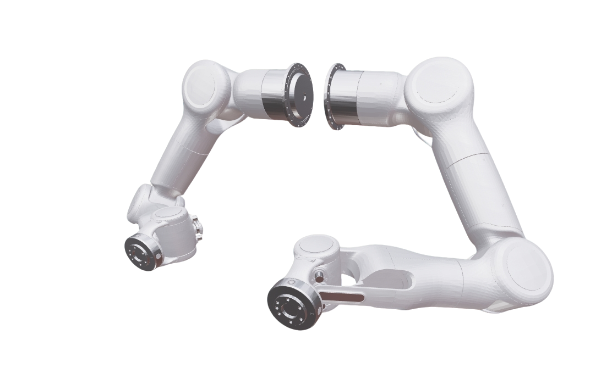
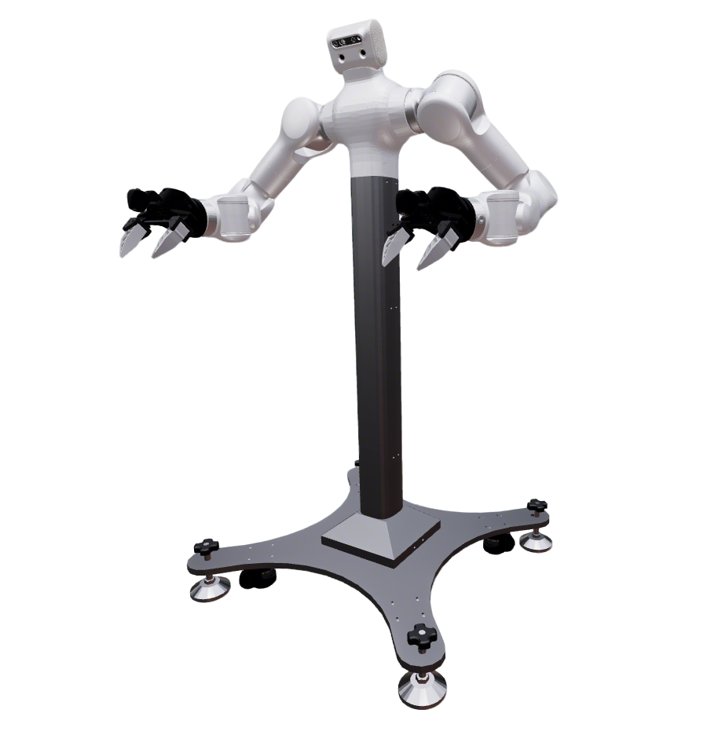

# Tianji Robots

天机（Tianji / Marvin）机械臂描述包：单臂 M6-SRS、双臂 M6-CCS / M6S Lite CCS / M20S-CCS，以及高立柱固定基座的 Marvin Pro。M6-CCS 的末端解析供 Marvin Pro 与 `fiveages_w2` 复用；M6S Lite 用于 Gento Luna。

| | |
|:---:|:---:|
|  |  |
| **[M6-SRS](m6_srs_description/)** | **[M6-CCS](m6_ccs_description/)** |
|  |  |
| **[M20S-CCS](m20s_ccs_description/)** | **[Marvin Pro](marvin_pro_description/)** |

## Packages

| Package | Launch `robot` | 形态 | 说明 |
|---------|----------------|------|------|
| [m6_srs_description](m6_srs_description/) | `m6_srs` | 单臂 | 左/右臂布局（`type:=left` / `right`） |
| [m6_ccs_description](m6_ccs_description/) | `m6_ccs` | 双臂平台 | 丰富末端；支持 `variant:=desktop` 展台；可接 Marvin 真机 |
| [m6s_lite_ccs_description](m6s_lite_ccs_description/) | `m6s_lite_ccs` | 双臂平台 | 更短行程 CCS（节长 0.264 m）；第一期仅 tcp；Gento Luna 使用 |
| [m20s_ccs_description](m20s_ccs_description/) | `m20s_ccs` | 双臂平台 | 更大行程 CCS；自有末端解析与挂载；仅仿真 / mock |
| [marvin_pro_description](marvin_pro_description/) | `marvin_pro` | 高立柱 + 双臂 | 复用 **M6-CCS** 臂与末端；默认 `marvin_gripper` |

相关夹爪包（M6-CCS / Marvin Pro）：[`marvin_gripper_description`](../../common/gripper/marvin_gripper_description/)（直板 / 45° 法兰）。

## Common Commands

### Build

```bash
cd ~/ros2_ws
colcon build --packages-up-to <package> --symlink-install
source ~/ros2_ws/install/setup.bash
```

将 `<package>` 替换为 `m6_srs_description`、`m6_ccs_description`、`m6s_lite_ccs_description`、`m20s_ccs_description` 或 `marvin_pro_description`。

### Visualize

```bash
ros2 launch robot_common_launch manipulator.launch.py robot:=<robot> collider:=simple
```

常用参数：

- `robot:=m6_srs` / `m6_ccs` / `m6s_lite_ccs` / `m20s_ccs` / `marvin_pro`
- `type:=<ee_key>`：对称末端（M6-CCS / M20S-CCS / Marvin Pro）
- `type:=left` / `right`：单臂布局（不要同时当末端键用）
- `left_type:=… right_type:=…`：左右不同末端（**不要**再传 `type:=`）
- `variant:=desktop`：仅 `m6_ccs` 展台，与 `type` 正交
- `collider:=simple`：规划用简化碰撞体（xacro 默认多为 `convex`）

末端键表：

- M6-CCS / Marvin Pro：[m6_ccs_description README §2](m6_ccs_description/README.md#2-末端执行器)（含真机驱动）
- M20S-CCS：[m20s_ccs_description README §2](m20s_ccs_description/README.md#2-末端执行器)（子集，仅 mock）

### OCS2 / Control

```bash
ros2 launch robot_common_launch manipulator_ocs2.launch.py robot_name:=<robot>
ros2 launch ocs2_arm_controller demo.launch.py robot:=<robot>
```

默认硬件为 `mock_components`。M6-CCS / Marvin Pro 真机加 `hardware:=real`；末端驱动方式通过 `left_ee_drive_type` / `right_ee_drive_type` 指定（细节见 [m6_ccs_description README](m6_ccs_description/README.md)）。M20S-CCS 当前无真机驱动。

## Layout

```text
Tianji/
├── .images/
├── m6_srs_description/
├── m6_ccs_description/
├── m6s_lite_ccs_description/
├── m20s_ccs_description/
└── marvin_pro_description/
```
